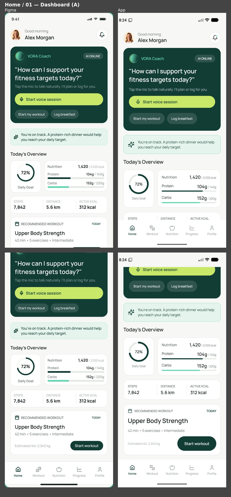
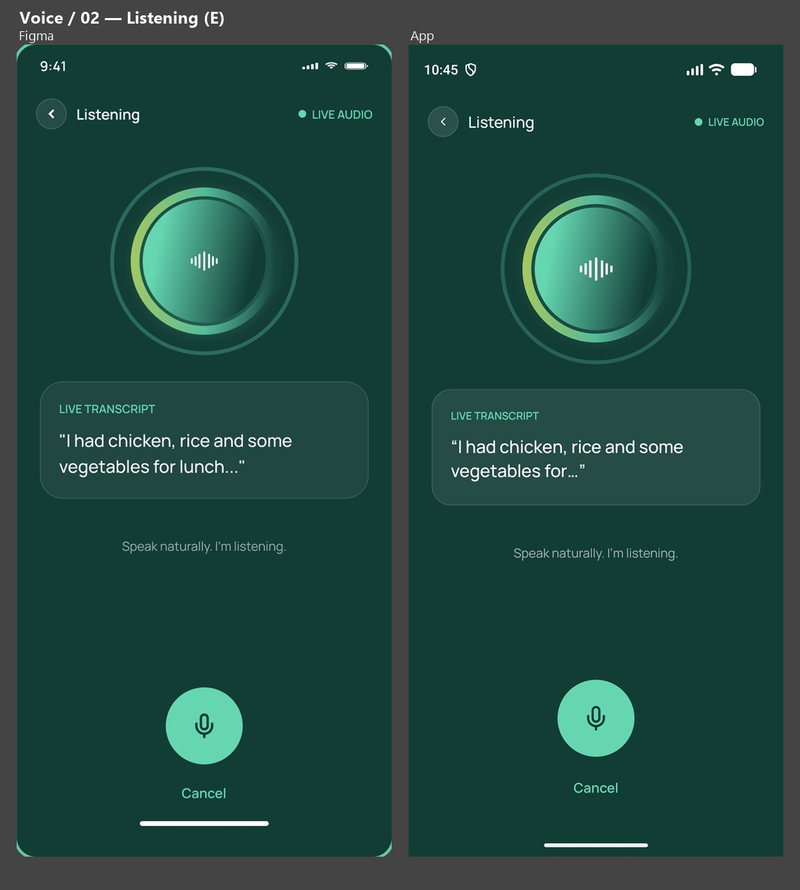
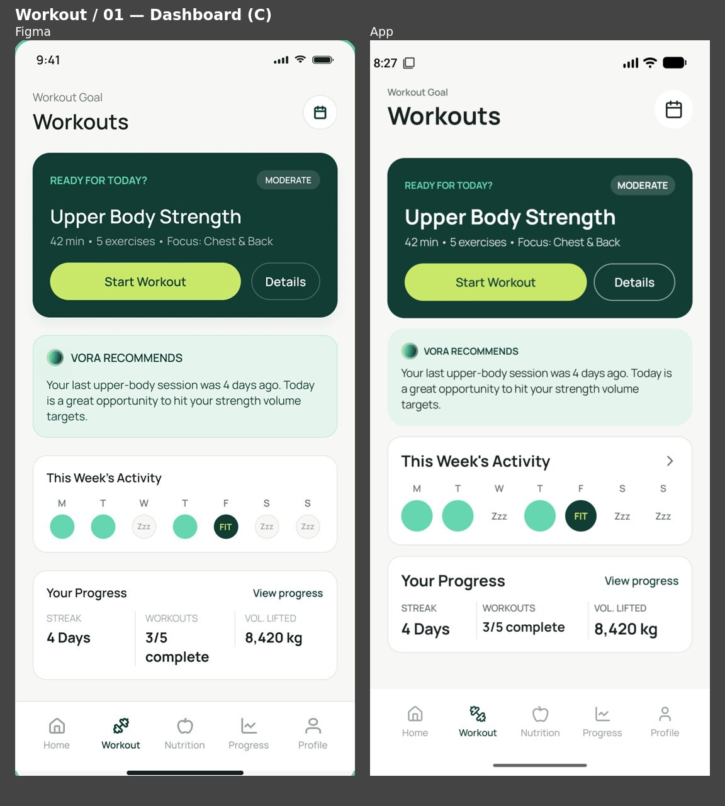
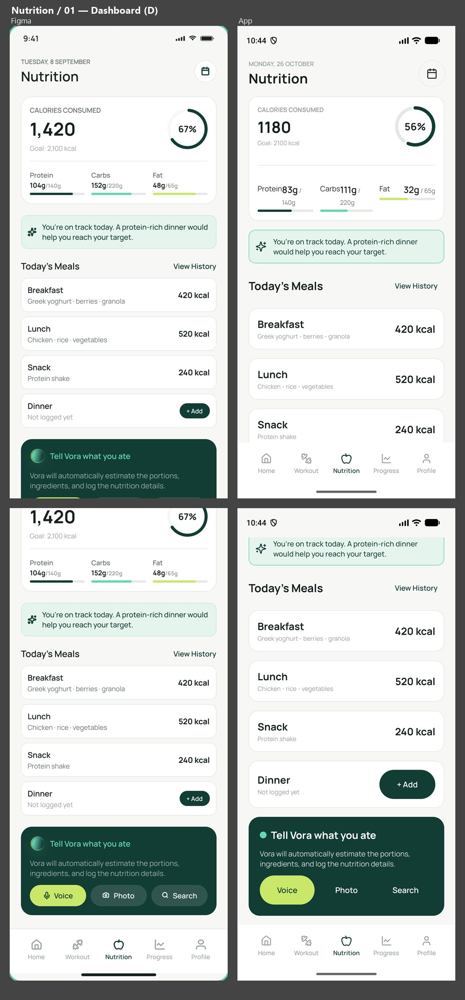
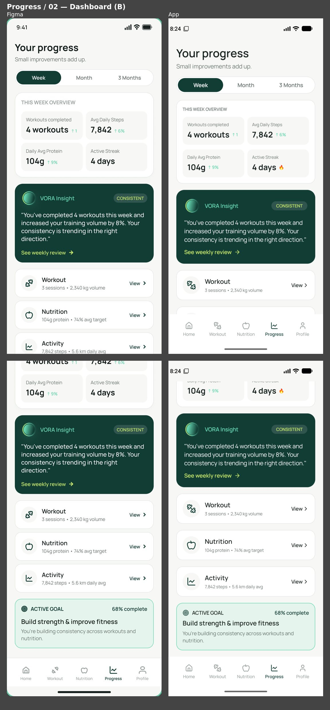

# VORA Coach — TP3 Grupo 1

App Android en Kotlin y Jetpack Compose basada en el diseño de VORA Coach (Desarrollo de Aplicaciones Móviles, Universidad ORT Argentina, 2026). Recorre los 7 flujos del diseño (Acceso, Inicio, Asistente VORA, Entrenamiento, Nutrición, Progreso y Perfil), con Retrofit y Room en el catálogo de entrenamientos y el registro de comidas.

- **Diseño:** [Figma — Parcial Domiciliario 7 Oct 26](https://www.figma.com/design/1nvbbfYNYmKAevuaG28J85/Parcial-Domiciliario-7-Oct-26)
- **Inventario de pantallas:** [docs/INVENTORY.md](docs/INVENTORY.md)
- **Base, tema y componentes:** [docs/BASE_SETUP.md](docs/BASE_SETUP.md)
- **Recursos exportados de Figma:** [docs/FIGMA.md](docs/FIGMA.md)

## Integrantes

| Integrante | GitHub | Área |
|---|---|---|
| Lucas Beronne | [@luckberonne](https://github.com/luckberonne) | Base, Hilt, tema, componentes de formulario, Acceso, Inicio, Perfil |
| Rodrigo Sanz | [@rodrisanz-ort](https://github.com/rodrisanz-ort) | Navegación, inventario, README, Progreso |
| Blas Laborde | [@blaslaborde](https://github.com/blaslaborde) | Entrenamiento, Retrofit, caché en Room |
| Ezequiel Diaz Trigo | [@EzeDiazTrigo](https://github.com/EzeDiazTrigo) | Nutrición, Room |
| Santino Menin | [@santinomenin-ort](https://github.com/santinomenin-ort) | Componentes de estado, barra inferior, recursos de Figma, Asistente VORA, QA visual |

## Cómo ejecutar

### Requisitos

- Android Studio (con su JBR como JDK de Gradle).
- Un emulador de **≈ 390 dp de ancho** como referencia de Figma (por ejemplo Pixel 7) y otro de tamaño distinto para verificar la adaptación.

### Compilar e instalar

Desde `TP3ParcialGrupo1/`:

```sh
./gradlew :app:assembleDebug        # compila
./gradlew :app:testDebugUnitTest    # tests unitarios
./gradlew :app:installDebug         # instala en el emulador conectado
```

También se puede abrir `TP3ParcialGrupo1/` en Android Studio y ejecutar la configuración `app`.

### Servidor

La app consume la VORA Mock API (sin autenticación).

| Opción | URL |
|---|---|
| Publicado | `https://tp3.martinrivas.ar/` (Swagger en `/docs`) |
| Local | `python3 mock/server.py` del paquete del docente → `http://localhost:8000` (desde el emulador: `http://10.0.2.2:8000/`) |

La URL base está en `di/NetworkModule.kt` (`BASE_URL`) y apunta al servidor publicado. Para usar el mock local desde el emulador:

1. Cambiar `BASE_URL` a `http://10.0.2.2:8000/`.
2. Permitir HTTP solo para desarrollo: `android:usesCleartextTraffic="true"` en `<application>` del `AndroidManifest.xml`.

No commitear ese cambio: la entrega usa el servidor publicado. La app solo pide el permiso `INTERNET`; no solicita micrófono ni cámara, porque la voz y la foto son simuladas (NAV05).

## Versiones

| Herramienta | Versión |
|---|---|
| Android Gradle Plugin | 9.4.1 |
| Gradle | 9.6.0 |
| Kotlin | 2.2.10 |
| KSP | 2.3.12 |
| Compose BOM | 2026.02.01 |
| Navigation Compose | 2.10.2 |
| Hilt | 2.60.1 |
| Retrofit / OkHttp | 3.0.0 / 5.5.0 |
| Room | 2.8.5 |
| SDK | min 24 · target 37 |

## Arquitectura

```
com.example.tp3_parcial_grupo_1
├─ navigation/     rutas (AppDestination), AppNavHost y un grafo por área
├─ ui/theme/       colores, tipografía, formas y espaciado del diseño
├─ ui/components/  componentes compartidos (botones, tarjetas, campos, anillo de progreso…)
├─ ui/strings/     textos visibles, uno por área
├─ ui/screens/     una carpeta por área: XxxRoute → XxxScreen + XxxViewModel + XxxUiState
├─ data/           repositorios, Retrofit (remote), Room (local) y datos de demostración (demo)
└─ di/             módulos de Hilt
```

- Cada pantalla tiene un `XxxRoute`, que obtiene su `ViewModel` con `hiltViewModel()` y observa el estado con `collectAsStateWithLifecycle`, y un `XxxScreen` sin estado con `@Preview`. Las pantallas no reciben el `NavController`: exponen callbacks que conecta la navegación.
- Los datos que no vienen de Retrofit ni Room están en `data/demo/` y se identifican como demostración.

### Capa de datos

**Entrenamiento (Retrofit con caché en Room).** `WorkoutApi` consulta `GET /v1/workouts` y `GET /v1/workouts/{id}`; las respuestas vienen envueltas en `DataResponse` y se leen como DTOs (`WorkoutSummaryDto`, `WorkoutDto`, `ExerciseDto`). `WorkoutMapper` los convierte en `WorkoutEntity` / `ExerciseEntity` para Room y en los modelos `Workout` / `Exercise` para la UI (`toEntity()` / `toDomain()`).

`WorkoutRepositoryImpl` separa lectura y actualización: las pantallas observan Room como `Flow` (`getWorkouts()`, `getWorkoutById()`), y `refreshWorkouts()` / `refreshWorkoutDetails()` piden los datos al servidor y actualizan la caché en una transacción. Si la red falla, devuelven `Result.failure` y la caché queda como estaba, así que lo ya descargado se sigue viendo sin conexión (RF02) y la pantalla avisa el error (con opción de reintentar cuando todavía no hay nada guardado).

**Nutrición (Room).** `MealRepository` trabaja sobre `MealDao`: observa las comidas de una fecha como `Flow`, agrega y elimina. `MealEntity` se convierte en `Meal` con `toDomain()` / `fromDomain()`. El total del día lo calcula `MealsViewModel` a partir de la lista observada, así que cambia al agregar o eliminar una comida.

**Base de datos.** `AppDatabase` (`vora_database`, versión 1) reúne `WorkoutEntity`, `ExerciseEntity` y `MealEntity`.

**Módulos de Hilt.** `NetworkModule` provee OkHttp, Retrofit y `WorkoutApi`; `DatabaseModule`, la base y los DAOs; `RepositoryModule` vincula `WorkoutRepository` con su implementación.

### Hilt e inyección de dependencias (RF08)

**Hilt es una capa sobre Dagger.** Dagger es el generador de código que resuelve el grafo de dependencias en tiempo de compilación: valida que cada objeto se pueda construir y genera las fábricas (`*_Factory`) y los componentes. Hilt le agrega lo específico de Android: los componentes estándar (`SingletonComponent`, `ActivityRetainedComponent`, `ViewModelComponent`, `ActivityComponent`…) y las anotaciones para engancharlos con `Application`, `Activity` y `ViewModel`. Así no se escriben `@Component` a mano: solo se declaran los módulos y qué objetos se inyectan. El procesamiento corre con KSP (`hilt-compiler`).

**Qué se declara en el código**

- `App` (`@HiltAndroidApp`): genera la clase base `Hilt_App` y el grafo completo `DaggerApp_HiltComponents_SingletonC`, con sus subcomponentes (`ActivityRetainedC`, `ActivityC`, `ViewModelC`…).
- `MainActivity` (`@AndroidEntryPoint`): se engancha a ese grafo y aloja `AppNavHost`.
- Cada `ViewModel` (`@HiltViewModel` + `@Inject constructor`) recibe sus repositorios por constructor. Las pantallas lo piden con `hiltViewModel()`, que usa la fábrica de Hilt; el `ViewModel` vive mientras exista su destino de navegación, por eso la rotación no lo recrea ni repite las consultas (RF07). `WorkoutDetailViewModel` y `MealsViewModel` reciben además el `SavedStateHandle` con el argumento de la ruta (`workoutId`, `mealId`).

**Qué construye Hilt (grafo de la app)**

| Objeto | Cómo se obtiene | Alcance |
|---|---|---|
| `OkHttpClient`, `Retrofit`, `WorkoutApi` | `@Provides` en `NetworkModule` | `@Singleton` |
| `AppDatabase` | `@Provides` en `DatabaseModule` (`Room.databaseBuilder`) | `@Singleton` |
| `WorkoutDao`, `ExerciseDao`, `MealDao` | `@Provides` en `DatabaseModule`, tomados de `AppDatabase` | — (`MealDao`: `@Singleton`) |
| `WorkoutRepositoryImpl` como `WorkoutRepository` | `@Binds` en `RepositoryModule`; la clase tiene `@Inject constructor` | `@Singleton` |
| `MealRepository` | `@Inject constructor` (no necesita módulo) | `@Singleton` |
| `ViewModel`s | `@HiltViewModel` | uno por destino de navegación |

Se usa `@Provides` para lo que no se puede construir con un constructor propio (Retrofit, OkHttp, Room y los DAO, que son de librerías) y `@Binds` para vincular una interfaz con su implementación.

**Un ejemplo de la cadena.** Al abrir el catálogo de entrenamientos, `hiltViewModel()` construye `WorkoutListViewModel`; para eso Hilt crea `WorkoutRepositoryImpl`, que necesita `WorkoutDao`, `ExerciseDao`, `WorkoutApi` y `AppDatabase`; la API necesita `Retrofit`, que necesita `OkHttpClient`. Ninguna pantalla ni `ViewModel` construye esos objetos: llegan por constructor, y por eso los tests reemplazan el repositorio o la API por fakes sin tocar la UI.

## Inventario de pantallas

Cada pantalla de Figma, su destino en la app y su estado: **funcional** (datos reales con Retrofit o Room) o **demostración** (datos de ejemplo identificados). Las rutas están en `navigation/AppDestination.kt`; el detalle de contenido y acciones por pantalla está en el [inventario](docs/INVENTORY.md).

| Figma | Destino | Estado |
|---|---|---|
| Login - 01 — SignIn | `auth/login` | demostración |
| Login - 02 — SignUp | `auth/register` | demostración |
| Home / 01 — Dashboard | `home/dashboard` | demostración |
| Home / 02 — Notifications | `home/notifications` | demostración |
| Voice / 01 — Idle | `coach` (estado `Idle`) | demostración |
| Voice / 02 — Listening | `coach` (estado `Listening`) | demostración |
| Voice / 03 — Processing | `coach` (estado `Processing`) | demostración |
| Voice / 04 — Speaking | `coach` (estado `Reply`) | demostración |
| Voice / 05 — Conversation | `coach` (estado `Conversation`) | demostración |
| Voice / 06 — Error | `coach` (estado `MicError`) | demostración |
| Workout / 01 — Dashboard | `workout/dashboard` | funcional (catálogo Retrofit + caché Room) |
| Workout / 02 — Weekly Plan | `workout/weekly_plan` | demostración |
| Workout / 03 — Workout Details | `workout/detail/{workoutId}` | funcional (detalle Retrofit + caché Room) |
| Workout / 04 — Pre Workout | `workout/pre/{workoutId}` | demostración |
| Workout / 05 — Active Workout | `workout/active/{workoutId}` | demostración |
| Workout / 06 — Exercise Details | `workout/exercise/{workoutId}/{exerciseId}` | demostración |
| Workout / 07 — Workout Complete | `workout/complete/{workoutId}` | demostración |
| Nutrition / 01 — Dashboard | `nutrition/dashboard` | funcional (total diario desde Room) |
| Nutrition / 02 — Today's Meals | `nutrition/todays_meals` | funcional (listado por fecha en Room) |
| Nutrition / 03 — Add Food | `nutrition/add_food` | funcional (carga manual en Room) |
| Nutrition / 04 — Voice Food Logging | `nutrition/voice_logging` | demostración |
| Nutrition / 05 — Food Analysis | `nutrition/food_analysis` | demostración |
| Nutrition / 06 — Photo Analysis | `nutrition/photo_analysis` | demostración |
| Nutrition / 07 — Food Confirmation | `nutrition/food_confirmation` | funcional (guarda en Room) |
| Nutrition / 08 — Meal Details | `nutrition/meal/{mealId}` | funcional (detalle y eliminación en Room) |
| Progress / 01 — Today's Overview | `progress/todays_overview` | demostración |
| Progress / 02 — Dashboard | `progress/dashboard` | demostración |
| Progress / 03 — Workout Progress | `progress/workout` | demostración |
| Progress / 04 — Nutrition Progress | `progress/nutrition` | demostración |
| Progress / 05 — Health Trends | `progress/health_trends` | demostración |
| Progress / 06 — Weekly Review | `progress/weekly_review` | demostración |
| Profile / 01 — Dashboard | `profile/dashboard` | demostración |
| Profile / 02 — Edit Profile | `profile/edit` | demostración |
| Profile / 03 — Goals & Preferences | `profile/goals` | demostración |
| Profile / 04 — Nutrition Preferences | `profile/nutrition_preferences` | demostración |
| Profile / 05 — Voice & AI Settings | `profile/voice_ai` | demostración |
| Profile / 06 — Settings | `profile/settings` | demostración |

Pantallas propias sin frame en Figma: el formulario de carga manual de comidas (`nutrition/manual_log`, funcional en Room), que se abre desde «Log Manually» en Add Food.

## Navegación

- La app arranca en **Login**. El acceso es de demostración: *Sign In* con cualquier mail válido y una contraseña de 8 caracteres o más entra sin servidor. Iniciar sesión o registrarse lleva a Home y saca Acceso del historial: atrás desde Home cierra la app. Cerrar sesión desde Settings vuelve a Login y limpia el historial.
- **Barra inferior:** Home, Workout, Nutrition, Progress y Profile. Se muestra solo en las pantallas que la tienen en Figma, cada tab conserva la última pantalla visitada y atrás desde otro tab vuelve a Home.
- **Selección coherente:** el detalle de entrenamiento recibe su `workoutId`, la guía de ejercicio `workoutId` y `exerciseId`, y el detalle de comida su `mealId`.
- **Recorridos que Figma no define:** el diseño no tiene interacciones de prototipo, así que donde no hay un control explícito el equipo eligió el destino:
  - El tab **Progress** abre *Your progress*; *Today's Overview* se abre desde la sección homónima de Home.
  - Cada notificación abre su área: revisión semanal, plan semanal, nutrición y progreso de entrenamiento.
  - **Progreso:** el Dashboard abre Workout Progress, Nutrition Progress y Health Trends desde sus accesos, y *See weekly review* abre la revisión semanal. En la revisión, atrás y *Done* vuelven a la pantalla anterior, *Ask VORA* abre el Asistente, *Get dinner ideas* el tab Nutrition y *View next week's plan* el plan semanal. *Start Workout* de Today's Overview abre el tab Workout, igual que en Home.
  - **Asistente:** se abre desde Home (*Start voice session*) y desde la revisión semanal (*Ask VORA*). Atrás desde cualquier estado vuelve a *Idle*, y desde *Idle* sale del Asistente.
  - **Nutrición:** Add Food ofrece voz, foto y carga manual. Guardar una comida (desde la carga manual o desde la revisión del análisis) vuelve al Dashboard de Nutrition con el total del día actualizado.
- **Saltos entre áreas:** un acceso que lleva a otra área (Log breakfast, notificaciones, Get dinner ideas, View next week's plan) pasa primero por su tab y después abre la pantalla, para que el tab quede marcado y atrás vuelva a su inicio. Tocar el tab en el que ya estás vuelve a su pantalla inicial.

## Estado por funcionalidad

| Área | Pantallas | Estado |
|---|---|---|
| Acceso | 2 | Demostración: validación local de los campos, sin Firebase |
| Inicio | 2 | Demostración: datos de ejemplo (`data/demo/`) |
| Asistente VORA | 6 estados | **Funcional (extra):** chat escrito con `POST /v1/coach/messages` (Retrofit) e historial en Room · voz simulada, sin permiso de micrófono |
| Entrenamiento | 7 | **Funcional:** catálogo y detalle con Retrofit y caché en Room · Weekly Plan, Pre Workout, Active Workout, Exercise Details y Workout Complete: pendientes (placeholder) |
| Nutrición | 8 | **Funcional:** carga manual, listado por fecha, eliminación con confirmación y total diario en Room · voz, foto y búsqueda simuladas |
| Progreso | 6 | Demostración: datos de ejemplo identificados |
| Perfil | 6 | Demostración: perfil local en memoria, editable entre pantallas; sin servidor |

El detalle por pantalla (nombre en Figma, ruta, barra inferior y estado) está en el [inventario](docs/INVENTORY.md).

## Idioma de la interfaz

Los textos visibles siguen el idioma del diseño de Figma (inglés), incluidos los mensajes que el diseño no muestra, para no mezclar idiomas en una misma pantalla. El código y los identificadores están en inglés.

## Video de demostración

> Pendiente.

## Comparaciones visuales

Figma a la izquierda y la app a la derecha, a la misma escala (emulador en 390 × 844 dp, el tamaño de los frames). Cómo se generan y qué muestra cada una: [docs/comparisons](docs/comparisons/README.md); diferencias pendientes por dueño: [docs/QA.md](docs/QA.md).

| Home / 01 · Dashboard | Voice / 02 · Listening |
|---|---|
|  |  |

| Workout / 01 · Dashboard | Nutrition / 01 · Dashboard |
|---|---|
|  |  |

| Progress / 02 · Dashboard |
|---|
|  |

## Uso de IA generativa

> Pendiente: declaración redactada por el equipo.
